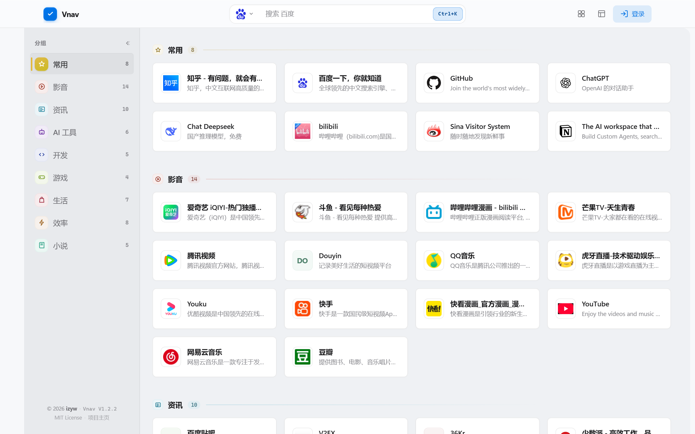
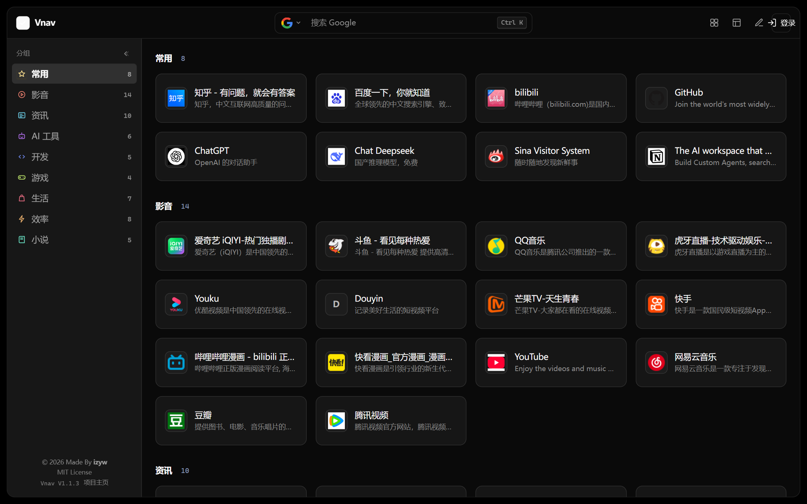

<div align="center">
  
  <h1>Vnav</h1>
  <p><strong>把常用站点摆成一屏的上网导航（浏览器起始页）</strong><br>
  一个 PHP 目录、一个 SQLite 文件，传上去就能用。</p>
  <p>
    
    
    
    
    
  </p>
  <p><a href="https://home.000018.xyz/"><strong>在线演示 →</strong></a></p>
</div>

不需要 Docker、MySQL 或 Node，PHP 能跑它就能跑。备份就是拷走 `data/home.db` 一个文件，换台机器再拷回来。

<p align="center">
  <br>
  <sub>默认皮肤 Atlas：左侧分组、右侧卡片，一行四张，点开即走</sub>
</p>

## 为什么

商业导航站广告多、页面花哨，点进去先看一屏推广，交互也谈不上好用。开源的替代品同样不顺手：多数要先登进后台，逐条添加链接、编辑分组、调整排序，改一遍要点好几页；有的还收费。

所以动手写了一个：**能拖的就不填表，一步能做完的不拆成三步。** 用着顺手，就开源出来，谁都可以拿去用。

## 特性

- **粘贴即收藏** —— 复制网址，在主页按 `Ctrl` + `V`，标题、描述、图标自动补全并入库，不用打开后台填表。
- **拖拽排序** —— 编辑模式下按住卡片即可拖动，可跨分组，也可拖到侧栏组名上整组归过去；松手生效，无需保存。
- **批量操作** —— 勾选多张卡片，一次完成移入分组、补图标、拉信息、删除。
- **预置默认数据** —— 自带 9 个分组、67 条常用站点，装完即用；后台可一键清空换自己的。
- **零外部请求** —— 图标抓取后存本地，搜索引擎 logo 与字体自托管。页面不加载外部资源，断网可打开（搜索除外）。
- **一包三用** —— 同一个 zip 既是安装包、升级包，也是恢复包；后台传包即升级，允许版本号回退。
- **轻量** —— 316 条站点时首屏 HTML 未压缩 108 KB，gzip 后 16 KB；服务端渲染，禁用 JS 仍可浏览。
- **安全** —— 登录含验证码与失败锁定，写接口按用户隔离数据，抓取外部地址时逐跳校验重定向，并补齐安全响应头。

## 界面

两套并列的设计语言，不是同一套换个配色。

| 皮肤 | 取向 | 明暗 |
| :--- | :--- | :--- |
| **Atlas**（默认） | 白纸黑字、发丝线、圆角与留白 | 亮 / 暗 / 跟随系统 |
| **工作台** Frame | 整个应用收进一张带边框的圆角框，顶栏、侧栏、主区三块并列 | 亮 / 暗 |

布局有卡片、横排、紧凑、宫格四种；分组默认在左侧一整列，可收起成 68px 的图标条。

每个分组固定一种颜色——侧栏那枚色块、组标题的小图标、卡片悬停时掺进边框的那点组色，用的是同一个色相。颜色因此能当地图用，而不只是装饰。

<p align="center">
  <br>
  <sub>同一套网格换成石墨底：层次不变，夜里不刺眼</sub>
</p>

<br>

<p align="center">
  <br>
  <sub>工作台皮肤：应用被收进一张框里，顶栏、侧栏、主区三块并列</sub>
</p>

<br>

<p align="center">
  <br>
  <sub>同一张框换成石墨底：外框、侧栏、主区还是三层，只是底翻过来</sub>
</p>

## 安装

### 环境要求

| 项目 | 要求 |
| :--- | :--- |
| PHP | 8.1 及以上 |
| 扩展 | 必需 `pdo_sqlite`、`mbstring`；自动抓取标题与图标另需 `curl` |
| 数据库 | 不需要。数据全在一个 SQLite 文件里 |
| 运行环境 | 虚拟主机、VPS、NAS、树莓派均可 |

```bash
php -m | grep -E 'pdo_sqlite|mbstring'
```

### 四步部署

1. **上传** —— 把整个目录传到网站根目录，或任意子目录。
2. **安装** —— 浏览器打开 `install.php`，填站点名与管理员账号、密码。
3. **收尾** —— 装完删掉 `install.php`。
4. **补图标** —— 后台「链接」页点一次「一键刷新名称、描述与图标」。

自动抓取需要 PHP 能访问外网。没有也能用，手动填写标题和网址即可。

### 升级

不必重装。后台「升级」页上传新版本 zip，程序只替换程序文件，跳过 `data/` 与 `inc/config.php`，链接、分组、账号不受影响。传错了用旧包再传一次即回退。

### 本地试跑

```bash
git clone https://github.com/izyw/VNav.git
cd VNav
php -S 127.0.0.1:8848 -t .
# 打开 http://127.0.0.1:8848/install.php
```

Nginx / Apache 完整配置、目录权限与安全检查见 **[部署说明.md](部署说明.md)**。

## 常见问题

### 抓取时报 `unable to get local issuer certificate`

缺 CA 证书，与安装本身无关。下载 <https://curl.se/ca/cacert.pem>，在 `php.ini` 里把 `curl.cainfo` 与 `openssl.cafile` 指向它。

### 装完很多卡片只是字母块

预置数据只存分组、标题、网址与描述，不含图标——那些图标是各站点的 favicon，商标归各站所有，不适合同 MIT 一起分发，抓一次即可生成。后台点一次「一键刷新」就补齐了。

## 备份与迁移

全部数据都在 `data/`：SQLite 数据库、图标缓存、会话。拷走即备份，拷回即迁移，不依赖任何外部服务。

## 目录结构

```
Vnav/
├── index.php        主页，服务端渲染
├── login.php        登录（验证码、失败锁定）
├── admin.php        后台：链接 / 分组 / 外观 / 统计 / 安全 / 升级 / 日志 / 说明
├── api.php          JSON 写接口
├── install.php      一次性安装向导，装完请删除
├── inc/             引导、建表、抓取、压缩、地理库、升级、默认数据种子
├── assets/          原生 CSS / JS，无构建步骤，无框架
└── data/            SQLite 数据库与图标缓存（不入库）
```

## 文档

- **[部署说明.md](部署说明.md)** —— 上传、赋权、运行向导、安全检查
- **[docs/设计说明.md](docs/设计说明.md)** —— 每个设计决定的依据，以及踩过的坑

## 许可

代码以 [MIT](LICENSE) 授权。文档中出现的站点名称与图标归各自所有者，仅作示例。
