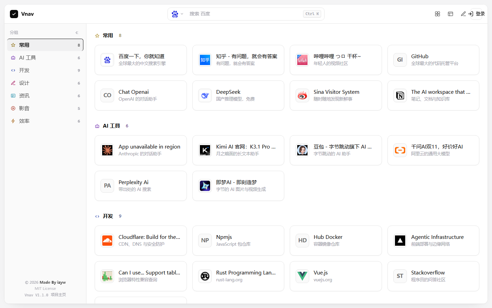

<div align="center">
  
  <h1>Vnav</h1>
  <p><strong>自托管的浏览器起始页。一个 PHP 目录 + 一个数据库文件，传上去就能用。</strong></p>
  <p>
    
    
    
    
    
  </p>
</div>


把常用站点按分类摆成一屏，点开即走。不需要 Docker、不需要 MySQL、不需要 Node，也不需要在服务器上装任何东西——PHP 能跑，它就能跑。备份是拷走 `data/home.db` 一个文件，换台机器再拷回来。

## 为什么值得用

**粘贴即收藏。** 复制一个网址，在主页按 `Ctrl+V`，标题、描述、图标就都自动填好了，直接入库。不用打开后台，不用填表。

**整组拖动排序。** 编辑模式下按住卡片就能拖，能拖进别的分组，也能直接拖到侧栏组名上整张归过去。排完不用保存——松手即生效。

**批量整理，不用逐个点。** 编辑模式下每张卡片左上角有勾选框，勾一批就能一次**移到分组、拉取图标、拉取信息、删除**。几百条站点从乱到齐，十几分钟的事。

**装完就有东西可点。** 自带 9 个分组、67 条常用站点，不是打开一个空页面从零加起。想清空换成自己的，后台一键清理。

**数据全在自己手里。** 图标抓一次存本地，搜索引擎用官方 logo 的本地文件，字体自托管。页面本身不向第三方要任何资源，断网也能打开（搜索除外）。

**一包三用。** 同一个 zip 既是安装包、也是升级包、也是恢复包。升级页上传即完成，版本号倒退也允许——改坏了能原地滚回去。

**尺寸实在。** 首页 HTML 未压缩 108 KB（316 条站点），gzip 后 16 KB。服务端渲染，关掉 JS 也能看。

## 界面

两套皮肤。**Atlas** 走系统级灰阶：白卡柔影、胶囊搜索框，三态（亮 / 暗 / 跟随系统）。**工作台**（Frame）把整个应用装进一个带边框的框里，三区并列。




布局有卡片 / 横排 / 紧凑 / 网格四选；分组默认在左侧一整列，可收起成 68px 的图标条。每个分组有固定颜色（颜色跟着分组走，不跟着排序走），侧栏、组标题、卡片悬停都是同一个色相——扫一眼就知道自己在哪一区。

## 怎么装

**环境**：PHP 8.1 以上，带 `pdo_sqlite` 和 `mbstring` 两个扩展。虚拟主机、VPS、NAS、树莓派都行，不需要数据库服务。

```bash
php -m | grep -E 'pdo_sqlite|mbstring'
```

想让它自动抓标题和图标，PHP 还需要能访问外网（`curl` 扩展 + 一份 CA 证书，见下方）。没有也不影响使用，手动填就是了。

**上传**：把这个目录传到网站的根目录，或者任意子目录。

**安装**：浏览器打开 `install.php`，填站点名和管理员账号密码，点安装。装完把 `install.php` 删掉。

**开始用**：打开首页，右上角登录。图标在后台「图标」页点一次「补图标」就补齐了。

**以后升级**：不用重新安装。到后台「升级」页，把新版本的 zip 包直接传上去就行——它只替换程序文件，跳过 `data/` 和 `inc/config.php`，链接、分组、账号一个都不会动。传错了还能用旧包再传一次滚回去（版本号倒退也允许）。

本地试跑同一条路：

```bash
git clone https://github.com/izyw/VNav.git
cd VNav
php -S 127.0.0.1:8848 -t .
# 打开 http://127.0.0.1:8848/install.php
```

**抓取报 `unable to get local issuer certificate`** 是缺 CA 证书，跟安装无关。下载 <https://curl.se/ca/cacert.pem>，在 `php.ini` 里把 `curl.cainfo` 和 `openssl.cafile` 指向它。

Nginx / Apache 的完整配置、目录权限、安全检查，见 **[部署说明.md](部署说明.md)**。

## 目录结构

```
VNav/
├── index.php        主页，服务端渲染
├── login.php        登录（验证码、失败锁定）
├── admin.php        后台：链接 / 分组 / 外观 / 统计 / 安全 / 升级 / 日志 / 说明
├── api.php          JSON 写接口
├── install.php      一次性安装向导，装完请删除
├── inc/             引导、建表、抓取、压缩、地理库、升级、默认数据种子
├── assets/          原生 CSS / JS，无构建步骤，无框架
└── data/            SQLite 数据库与图标缓存（不入库）
```

## 备份与迁移

你的全部数据都在 `data/` 里——数据库、图标缓存、会话。把这个目录拷走就是备份，拷回就是迁移。

默认数据不带图标：`inc/seed.php` 里只有分组、标题、网址和描述。图标是各家站点的 favicon，商标归各站点所有，不适合跟着 MIT 一起分发；而且它本来就是抓一次就有的东西。

## 文档

- **[部署说明.md](部署说明.md)** —— 上传、赋权、跑向导、安全检查，按步骤走
- **[docs/设计说明.md](docs/设计说明.md)** —— 每个决定的依据，以及踩过的坑

## 许可

代码以 [MIT](LICENSE) 授权。文档中出现的站点名称与图标归各自所有者，仅作示例。
