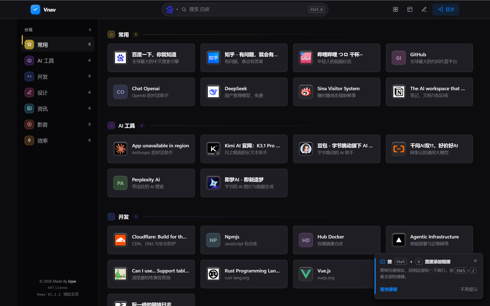

<div align="center">
  
  <h1>Vnav</h1>
  <p><strong>真正好用的开源上网导航（浏览器起始页）。一个 PHP 目录、一个 SQLite 文件，传上去就能用。</strong></p>
  <p>
    
    
    
    
    
  </p>
  <p><strong>在线演示：<a href="https://home.000018.xyz/">home.000018.xyz</a></strong></p>
</div>


把常用站点按分组摆成一屏，点开即走。不需要 Docker、MySQL 或 Node，PHP 能跑它就能跑。备份就是拷走 `data/home.db` 一个文件，换台机器再拷回来。

## 初衷

商业导航站广告多、页面花哨，点进去先看一屏推广，交互逻辑也谈不上。找开源的替代品同样不顺手：多数要先登进后台，逐条添加链接、编辑分组、调整排序，改一遍要点好几页；有的还收费。

所以动手写了一个：能拖的就不填表，一步能做完的不拆成三步。用着顺手，就开源出来，谁都可以拿去用。

## 特性

**粘贴即收藏。** 复制一个网址，在主页按 `Ctrl+V`，标题、描述、图标自动补全并入库，不用打开后台填表。

**拖拽排序。** 编辑模式下按住卡片即可拖动，可跨分组，也可拖到侧栏组名上整组归过去。松手生效，无需保存。

**批量操作。** 编辑模式下勾选多张卡片，一次完成移入分组、拉取图标、拉取信息、删除。

**预置默认数据。** 自带 9 个分组、67 条常用站点，装完即可使用；后台可一键清空换成自己的。

**不依赖第三方资源。** 图标抓取后存本地，搜索引擎 logo 与字体均自托管。页面不加载外部资源，断网可打开（搜索除外）。

**一个包三种用途。** 同一个 zip 既是安装包、升级包，也是恢复包。后台传包即完成升级，允许版本号回退。

**轻量。** 316 条站点时首页 HTML 未压缩 108 KB，gzip 后 16 KB。服务端渲染，禁用 JS 仍可浏览。

**安全。** 登录含验证码与失败锁定，写接口按用户隔离数据，抓取外部地址时逐跳校验重定向，并补齐安全响应头。

## 界面

两套皮肤。**Atlas** 走系统级灰阶：白卡柔影、胶囊搜索框，亮 / 暗 / 跟随系统三态。**工作台**（Frame）把整个应用装进带边框的框内，三区并列。




布局有卡片 / 横排 / 紧凑 / 网格四种；分组默认在左侧一整列，可收起为 68px 图标条。每个分组固定一种颜色，侧栏、组标题、卡片悬停共用同一色相。

## 安装

**环境**：PHP 8.1 以上，需 `pdo_sqlite` 与 `mbstring` 扩展。虚拟主机、VPS、NAS、树莓派均可，不需要数据库服务。

```bash
php -m | grep -E 'pdo_sqlite|mbstring'
```

自动抓取标题与图标需要 PHP 能访问外网（`curl` 扩展 + CA 证书，见下）。没有也能用，手动填写即可。

**上传**：将目录传到网站根目录或任意子目录。

**安装**：浏览器打开 `install.php`，填站点名与管理员账号密码。装完删除 `install.php`。

**开始用**：打开首页，右上角登录。图标在后台「图标」页点一次「补图标」即可补齐。

**升级**：无需重装。在后台「升级」页上传新版本 zip，程序只替换程序文件，跳过 `data/` 与 `inc/config.php`，链接、分组、账号不受影响。传错可用旧包再传一次回退。

本地试跑同样流程：

```bash
git clone https://github.com/izyw/VNav.git
cd VNav
php -S 127.0.0.1:8848 -t .
# 打开 http://127.0.0.1:8848/install.php
```

**抓取报 `unable to get local issuer certificate`** 是缺 CA 证书，与安装无关。下载 <https://curl.se/ca/cacert.pem>，在 `php.ini` 中把 `curl.cainfo` 和 `openssl.cafile` 指向它。

Nginx / Apache 完整配置、目录权限与安全检查见 **[部署说明.md](部署说明.md)**。

## 目录结构

```
VNav/
├── index.php        主页，服务端渲染
├── login.php        登录（验证码、失败锁定）
├── admin.php        后台：链接 / 分组 / 外观 / 统计 / 安全 / 升级 / 日志 / 说明
├── api.php          JSON 写接口
├── install.php      一次性安装向导，装完请删除
├── inc/             引导、建表、抓取、压缩、地理库、升级、默认数据种子
├── assets/          原生 CSS / JS，无构建步骤，无框架
└── data/            SQLite 数据库与图标缓存（不入库）
```

## 备份与迁移

全部数据都在 `data/`：数据库、图标缓存、会话。拷走即备份，拷回即迁移。

默认数据不含图标。`inc/seed.php` 只存分组、标题、网址与描述——图标是各站点的 favicon，商标归各站所有，不适合同 MIT 一起分发，且抓取一次即可生成。

## 文档

- **[部署说明.md](部署说明.md)** —— 上传、赋权、运行向导、安全检查
- **[docs/设计说明.md](docs/设计说明.md)** —— 设计决定的依据与踩过的坑

## 许可

代码以 [MIT](LICENSE) 授权。文档中出现的站点名称与图标归各自所有者，仅作示例。
